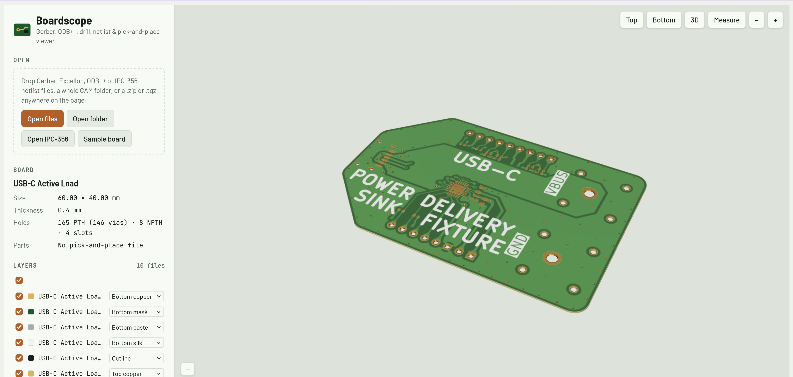

# Boardscope

Online Gerber viewer — try it live at **[https://gorniak.eu/boardscope/](https://gorniak.eu/boardscope/)**.

It shows Gerber, ODB++, Excellon drill and pick-and-place files as a 3D circuit board in the browser. Everything runs in the browser tab: files are never uploaded.

## Usage

Open `dist/index.html` in a browser, either from disk or from any static web host. It opens with the **USB-C Active Load** board. To view your own board:

- **Open files**: pick Gerber, drill and pick-and-place files.
- **Open folder**: pick a whole CAM output folder.
- **Drag and drop**: drop files, a folder or a `.zip` anywhere on the page.
- **Open IPC-356** (shown once a board is open): add an IPC-D-356 netlist to it.
- **Sample board**: reload the built-in USB-C Active Load board.

### Supported files

| Kind | Formats |
| --- | --- |
| Gerber | RS-274X and X2 (`.gbr`, `.gtl`/`.gbl`/`.gts`/…, KiCad, Altium, Eagle and other CAM names) |
| Drill | Excellon (`.drl`, `.xln`, …), plated and non-plated, routed slots |
| Pick and place | CSV / TSV / space-separated (`.pos`, `.csv`, `.txt`, `.xy`, Eagle `.mnt`/`.mnb`) |
| Netlist | IPC-D-356 / 356A (`.d356`, `.ipc`): hover a pad or via to see its net, click to highlight the whole net. Without a pick-and-place file, parts are placed from the netlist's pins. Opened on its own, a netlist (or pick-and-place file) is added to the board already open |
| ODB++ | A whole job: `.tgz`, `.tar`, `.zip` or the job folder. Layers, board profile, drills and components; `.Z`-compressed members are unpacked |
| Archives | `.zip`, `.tgz` / `.tar.gz` or `.tar` of any of the above |

Gerber layers are recognised from X2 `FileFunction` attributes or from file names; ODB++ layers come from the job's `matrix` file. For ODB++ jobs the **Stackup** panel lists the board layers top to bottom with thickness, material, copper weight and εr, and the 3D board uses the stackup's total thickness until you pick another in **Thickness**. If a layer is wrong, change its type with the drop-down in the layer list.

### Controls

| Action | How |
| --- | --- |
| Orbit / pan / zoom | drag / right-drag / scroll |
| Top, bottom, 3D view | <kbd>T</kbd>, <kbd>B</kbd>, <kbd>F</kbd> (or the toolbar) |
| Measure distance | <kbd>M</kbd>, then click two points |
| Nets view: copper coloured per net with each net's name written along its tracks, in its pads, around the rings of drilled pads, and as a repeating pattern over its pours (on when a netlist is loaded) | <kbd>N</kbd> |
| Net under the pointer / highlight a net (with an IPC-356 netlist) | hover / click a pad or via; click empty board to clear |
| Show / hide components | <kbd>P</kbd> |
| Show / hide via drills (holes and barrels; the pads stay) | <kbd>V</kbd> |
| Show / hide plated drills (metal barrels, vias included; turning vias on turns this on too) | <kbd>H</kbd> |
| Layer stack (board → spread → peel) | <kbd>L</kbd> |
| Zoom in / out | <kbd>+</kbd> / <kbd>−</kbd> |
| Move the board | arrow keys (<kbd>Shift</kbd> for bigger steps) |

The **Finish** panel sets solder mask and silkscreen colour, surface finish (ENIG, HASL, bare copper), board thickness, render detail and solder paste. **Layer stack** pulls the copper layers apart (Spread) or lets you peel them off one by one (Peel). These settings are saved in the browser.

Hovering over a placed component shows its reference, value, package and size.

## License

Boardscope is available under the MIT License. The vendored libraries in `vendor/` (JSZip, three.js) and the fonts in `fonts/` (SIL Open Font License) keep their own licences.

